from pathlib import Path

content = r'''<!--
  VOID PLAYER
  MIRAGE v3 · Version 3.0.0
  Official project README
-->

<div align="center">

  <h1>VOID PLAYER</h1>
  <h3>MIRAGE v3 · Version 3.0.0</h3>

  <p><strong>A more personal way to experience your music.</strong></p>

  <p>
    An offline-first Android music player focused on immersive visuals,
    thoughtful customization, and a listening experience that feels like your own.
  </p>

  <p>
    
    
    
    
  </p>

  <p>
    <a href="#-overview">Overview</a> ·
    <a href="#-visual-showcase">Screenshots</a> ·
    <a href="#-features">Features</a> ·
    <a href="#-mirage-v3">MIRAGE v3</a> ·
    <a href="#-project-structure">Project</a> ·
    <a href="#-getting-started">Getting started</a>
  </p>

</div>

---

## 🎧 Overview

**VOID PLAYER** is an Android music player built for people who want more than a basic list of audio files and a play button.

Its goal is to make listening to locally stored music feel immersive, personal, and visually coherent. The experience brings together a music library, playback controls, artwork-focused player designs, appearance customization, and personal touches for individual songs.

VOID PLAYER follows an **offline-first direction**: its core listening experience is designed around music available on the user's device rather than requiring a streaming subscription.

The interface uses a dark, premium visual language with glass-inspired surfaces, artwork-led presentation, and configurable visual elements.

### The idea

> Your music should feel like your space.

VOID PLAYER is shaped around three principles:

- **Personal:** make the listening experience reflect individual taste.
- **Immersive:** give album artwork and playback a distinctive visual presence.
- **Practical:** keep everyday music-library and playback interactions accessible.

---

## ✨ Highlights

| Area | What it brings |
|---|---|
| Local music library | Browse and listen to audio stored on the device |
| Full-screen player | An artwork-focused listening interface with playback controls |
| Artwork presentation | Classic Vinyl and Squaricle Liquid Glass styles |
| Appearance settings | Personalize the app's visual experience |
| Song customization | Personalize supported song information and comments |
| Listening utilities | Tools such as the sleep timer and equalizer |
| Music insights | Dedicated VOID Analytics experience |
| Creative workspace | VOID Studio experience |
| Dynamic visuals | Artwork-aware visual styling and accent colors |

---

## 🖼️ Visual Showcase

Explore the interface through the galleries below. Each gallery is arranged horizontally so screenshots can be browsed side by side.

### 01 · Home & Music Collection

The starting point for the listening experience: discover the music available in your collection and move through the app's library spaces.

<table>
  <tr>
    <td align="center">
      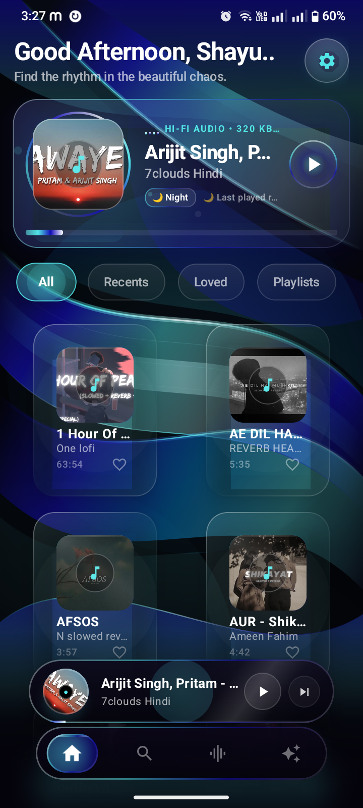
      <br><strong>Home Screen</strong>
      <br><sub>The main listening hub</sub>
    </td>
    <td align="center">
      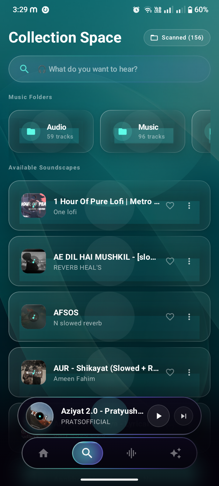
      <br><strong>Collection Space</strong>
      <br><sub>Your music collection</sub>
    </td>
    <td align="center">
      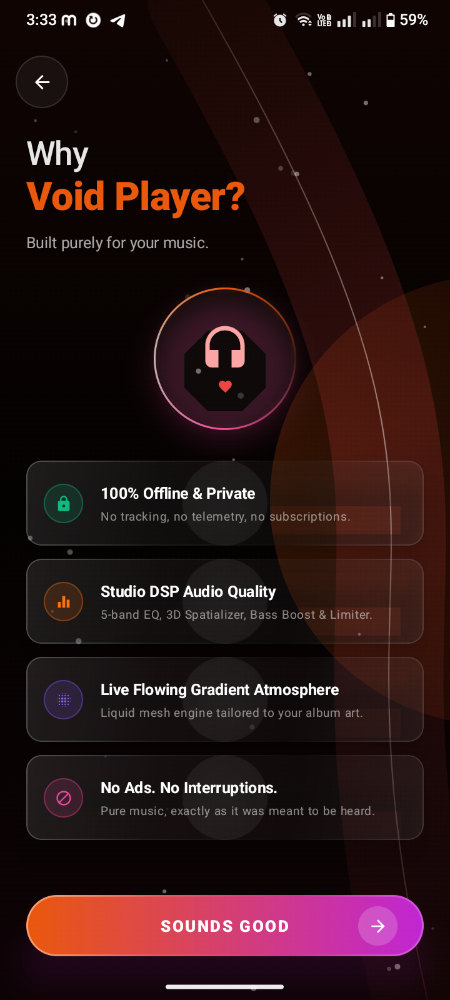
      <br><strong>Why VOID</strong>
      <br><sub>The product experience</sub>
    </td>
  </tr>
</table>

### 02 · Listening Experience

The player is designed to keep the current track, artwork, and playback actions at the center of attention.

<table>
  <tr>
    <td align="center">
      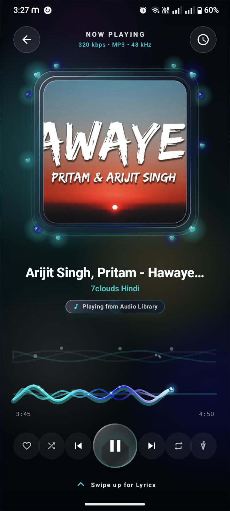
      <br><strong>Full Screen Player</strong>
      <br><sub>Artwork-led playback</sub>
    </td>
    <td align="center">
      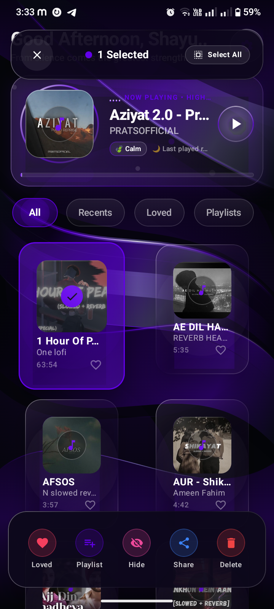
      <br><strong>More Options</strong>
      <br><sub>Additional track actions</sub>
    </td>
    <td align="center">
      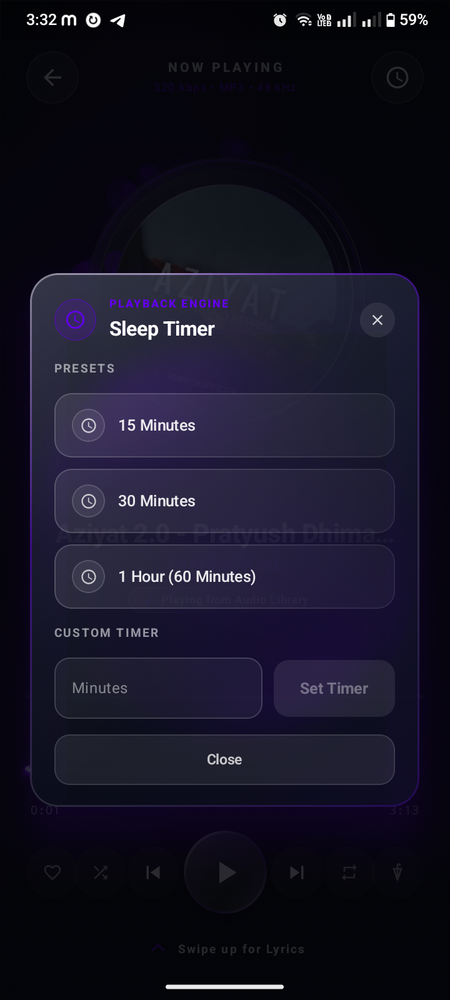
      <br><strong>Sleep Timer</strong>
      <br><sub>Timed listening</sub>
    </td>
  </tr>
</table>

### 03 · Artwork & Personalization

Give the player a distinct visual identity and add personal details to individual songs.

<table>
  <tr>
    <td align="center">
      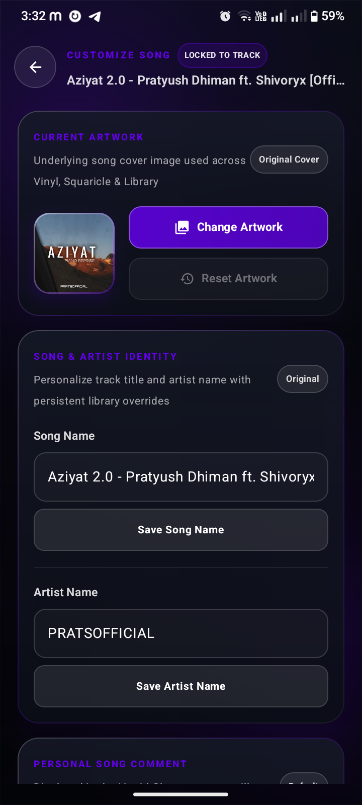
      <br><strong>Customize Song</strong>
      <br><sub>Individual song customization</sub>
    </td>
    <td align="center">
      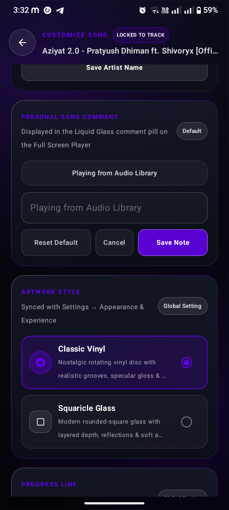
      <br><strong>Song Comment</strong>
      <br><sub>A personal note for a track</sub>
    </td>
    <td align="center">
      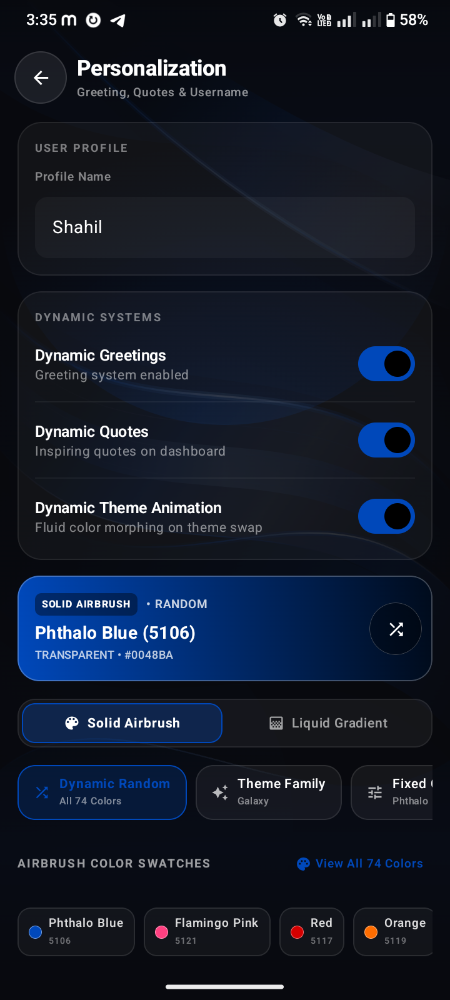
      <br><strong>Personalization</strong>
      <br><sub>Personal listening preferences</sub>
    </td>
  </tr>
</table>

### 04 · Appearance & Settings

Adjust the look and feel of the player through its appearance and experience settings.

<table>
  <tr>
    <td align="center">
      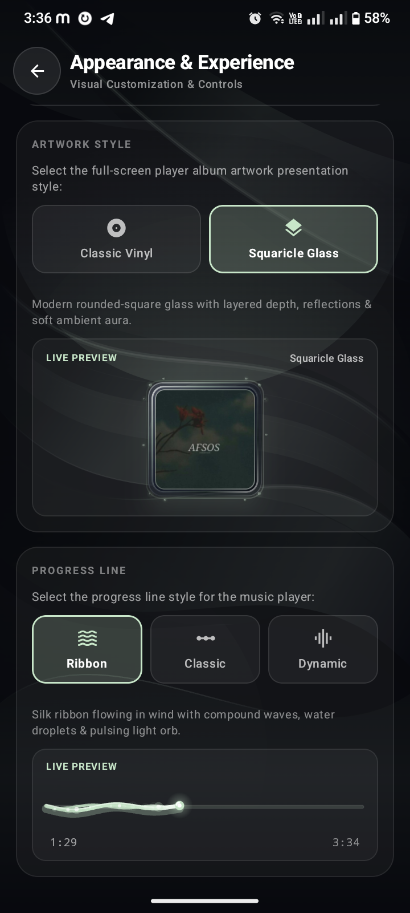
      <br><strong>Appearance</strong>
      <br><sub>Visual presentation options</sub>
    </td>
    <td align="center">
      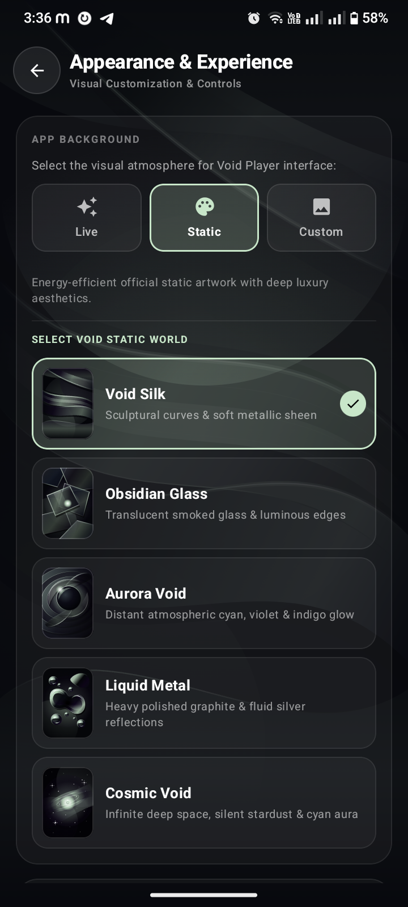
      <br><strong>Experience</strong>
      <br><sub>Listening experience options</sub>
    </td>
    <td align="center">
      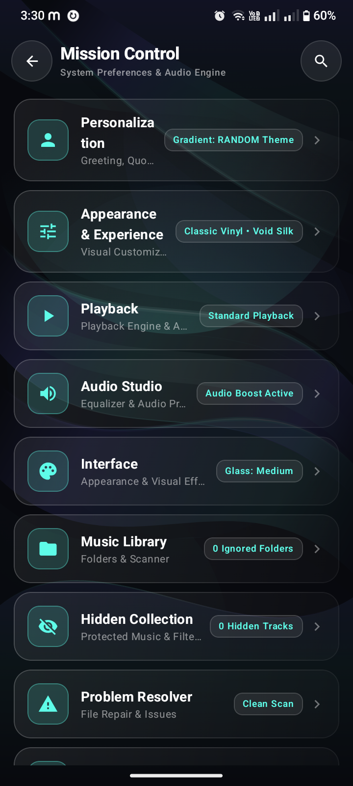
      <br><strong>Settings</strong>
      <br><sub>App configuration</sub>
    </td>
  </tr>
</table>

### 05 · Insights, Studio & App Information

Additional spaces for exploring listening information, creative tools, and application details.

<table>
  <tr>
    <td align="center">
      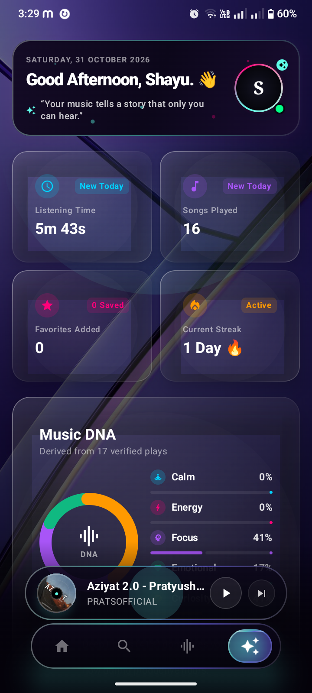
      <br><strong>VOID Analytics</strong>
      <br><sub>Listening insights</sub>
    </td>
    <td align="center">
      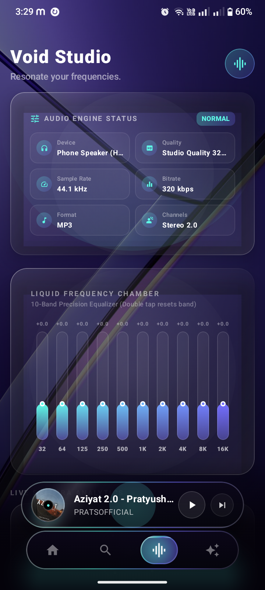
      <br><strong>VOID Studio</strong>
      <br><sub>Creative workspace</sub>
    </td>
    <td align="center">
      
      <br><strong>Developer</strong>
      <br><sub>Project information</sub>
    </td>
    <td align="center">
      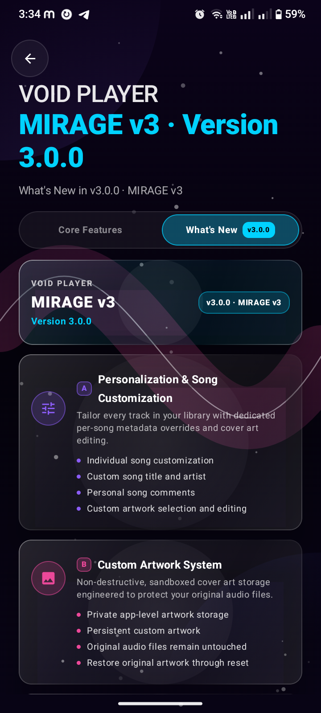
      <br><strong>What's New</strong>
      <br><sub>Release highlights</sub>
    </td>
  </tr>
</table>

---

## 🚀 Features

### 🎵 Local Music Library

VOID PLAYER is built around music stored on the device.

- Access supported local audio files through the app's music-library experience.
- Browse and navigate the available collection.
- Open tracks in the player and use the existing playback controls.
- Keep the core listening experience focused on locally available music.

### 🎚️ Full-Screen Listening Experience

The full-screen player gives the currently playing track a dedicated space.

- Artwork-focused presentation.
- Track information and playback controls.
- Multiple artwork presentation styles.
- Progress and seeking interactions.
- A visual experience designed to complement the current music artwork.

### 💿 Classic Vinyl

Classic Vinyl presents album artwork inside a circular, record-inspired composition.

- Circular artwork presentation.
- Vinyl-inspired rings and visual details.
- Rotation behavior associated with playback.
- A distinctive alternative to a conventional square album-art layout.

### 🧊 Squaricle Liquid Glass

Squaricle Liquid Glass offers a rounded-square artwork presentation with a layered, glass-inspired visual treatment.

- Rounded-square artwork framing.
- Translucent, glass-inspired presentation.
- A separate visual identity from Classic Vinyl.
- Designed to work with the app's artwork and accent-color experience.

### 🎨 Appearance & Experience Customization

The appearance settings provide ways to personalize the player's visual environment.

The project includes static and live background concepts, artwork styles, and progress-line presentation options. The exact options available depend on the current app build.

The visual system is designed to work with VOID PLAYER's existing dynamic accent-color behavior rather than forcing one fixed color scheme across every track.

### ✍️ Song Personalization

The Customize Song experience brings personal editing closer to the music itself.

Supported customization areas include:

- Song title.
- Artist name.
- Personal song comment.
- Artwork customization workflow.

These controls are intended to let users add their own personal touch to individual tracks.

### ⏱️ Listening Utilities

VOID PLAYER includes additional listening tools, including:

- Sleep Timer.
- Equalizer and preset controls.
- Additional track options and playback-related utilities.

### 📊 VOID Analytics

VOID Analytics is a dedicated area for music-related insights within the app.

### 🛠️ VOID Studio

VOID Studio is a separate creative/workspace area within the VOID PLAYER experience.

---

## 🌌 MIRAGE v3

**MIRAGE v3 · Version 3.0.0** is the current release identity documented by this repository.

The MIRAGE v3 direction focuses on a more personal listening experience, artwork presentation, and visual refinement.

### Release identity

| Property | Value |
|---|---|
| Product | VOID PLAYER |
| Release name | MIRAGE v3 |
| Version name | `3.0.0` |
| Platform | Android |
| Product direction | Offline-first music player |

### MIRAGE v3 focus areas

- Song-level personalization.
- Artwork customization experience.
- Classic Vinyl visual refinement.
- Squaricle Liquid Glass visual identity.
- Artwork-aware dynamic accent colors.
- Continued attention to visual consistency and playback reliability.

For the exact changes included in a published build, see the repository's [Releases](https://github.com/SHAHILShakya/Void-Player/releases) page and release notes.

---

## 🧭 Product Direction

VOID PLAYER is being developed as a personal music environment rather than just a basic audio-file browser.

The broader direction is to keep improving:

- The local music-library experience.
- Artwork and player presentation.
- Personalization at the individual-song level.
- Appearance and listening preferences.
- Reliability, performance, and day-to-day usability.

Future ideas and planned work may change as development progresses. A planned feature should not be considered available until it is implemented and included in a release.

---

## 🧰 Technology & Architecture

VOID PLAYER is an Android application.

This repository is intended to contain the project's source code and supporting documentation. Detailed technical information should be maintained alongside the actual implementation, including:

- Build system and required toolchain.
- Programming languages and UI framework.
- Audio playback and media-session architecture.
- Local data and persistence layer.
- Image and artwork-loading pipeline.
- Permission and storage behavior.

**Implementation note:** Only technologies and dependencies verified in the source code should be listed here. Do not infer the technology stack from the app's appearance or feature set.

---

## 📦 Getting Started

The source repository is being organized for public development.

Once the complete source tree and build configuration are published, this section should contain verified setup instructions.

A complete setup guide should document:

1. Required Android development tools and SDK versions.
2. How to clone the repository.
3. How to open and sync the project.
4. Required local configuration, if any.
5. How to build and run the application.
6. How to generate a release build.

Do not add API keys, signing credentials, keystores, passwords, or machine-specific configuration files to the repository.

---

## 📱 Releases

Official release information and downloadable builds, when published, will be available through:

**[VOID PLAYER · GitHub Releases](https://github.com/SHAHILShakya/Void-Player/releases)**

Each release should identify:

- Release name.
- Version name and version code where relevant.
- Release date.
- New features.
- Improvements.
- Bug fixes.
- Known limitations.
- Supported download artifacts.

---

## 🗂️ Repository Structure

The repository is intended to keep source code, visual references, and documentation organized.

```text
Void-Player/
│
├── README.md
├── screenshots/
│   ├── HomeScreen.png
│   ├── CollectionSpace.png
│   ├── FullScreenPlayer.png
│   ├── CustomizeSong.png
│   └── ...
│
├── Documentation/
│   └── Project documentation
│
├── Releases/
│   └── Release-related resources
│
└── Android project source
```

The tree above describes the intended documentation layout. Actual directories may differ as the source repository is populated.

---

## 🤝 Contributions

The project is currently maintained by its creator.

If you want to report an issue or suggest an improvement:

1. Check whether the issue has already been reported.
2. Include the app version and device/Android details where relevant.
3. Describe the steps needed to reproduce the issue.
4. Include screenshots or logs when they help explain the problem.
5. Never include private user data, API secrets, or signing credentials in an issue.

Contribution guidelines may be added as the public source repository matures.

---

## 🔐 Privacy & Security

When contributing or publishing code:

- Never commit API keys, access tokens, passwords, or private credentials.
- Never commit Android signing keystores or their passwords.
- Keep machine-specific local configuration out of version control.
- Review logs and screenshots for personal information before publishing.
- Report security-sensitive issues privately rather than posting exploitable details publicly.

---

## 📄 License

**No license has been selected for this repository yet.**

Until a license is added, the source code remains subject to applicable copyright law. Public visibility does not automatically grant permission to copy, modify, redistribute, or use the code commercially.

A license will be added once the project owner has selected the intended terms.

---

## 👨‍💻 Creator

**SHAHIL BAUDH [SHAYU]**

Creator and developer of VOID PLAYER.

- GitHub: [@SHAHILShakya](https://github.com/SHAHILShakya)
- Project: [VOID PLAYER](https://github.com/SHAHILShakya/Void-Player)

---

<div align="center">

  <h2>VOID PLAYER</h2>
  <h3>MIRAGE v3 · 3.0.0</h3>

  <p><strong>Your music. Your identity. Your experience.</strong></p>

  <sub>Built with care. Designed around the way you listen.</sub>

</div>
'''

path = Path("/mnt/data/VOID-PLAYER-README-FULL.md")
path.write_text(content, encoding="utf-8")
print(f"Created: {path}")
print(f"Size: {path.stat().st_size:,} bytes")
print(f"Lines: {len(content.splitlines())}")
